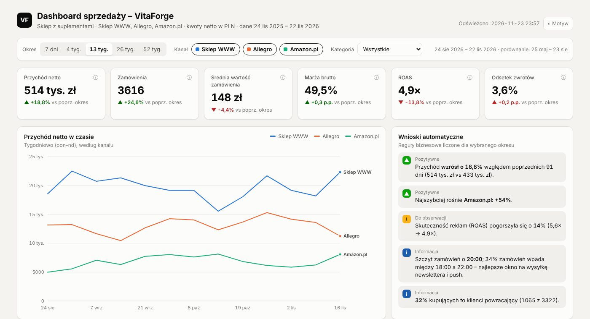
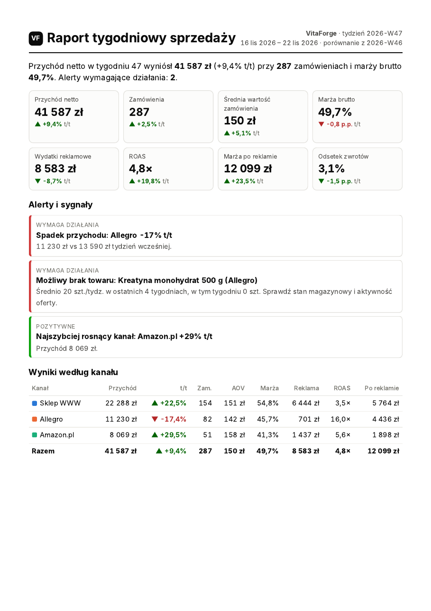
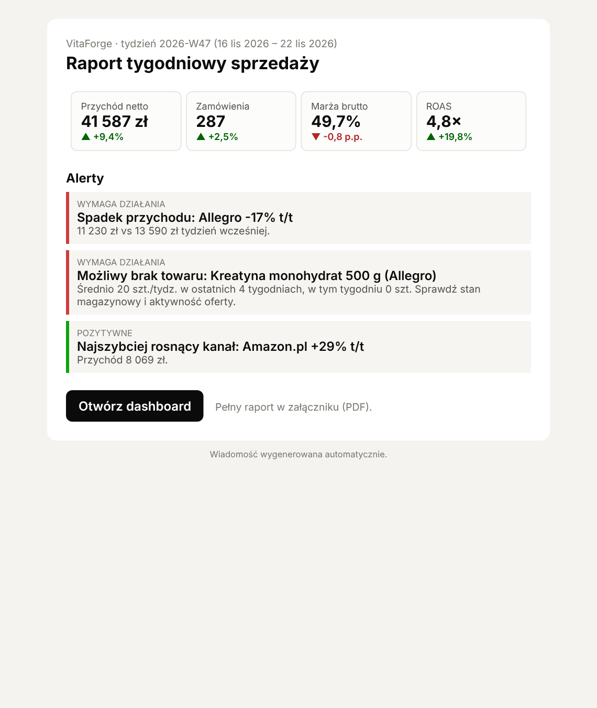
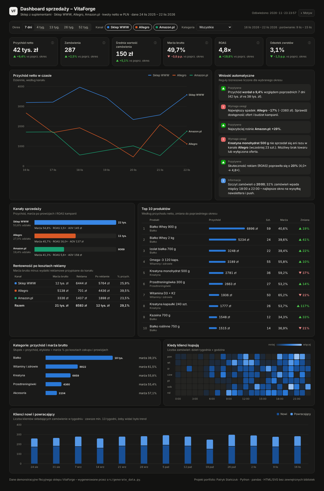

# Dashboard sprzedażowy z automatycznym raportem tygodniowym

**Automatyzacja raportowania dla sklepu e-commerce sprzedającego w 3 kanałach (Sklep WWW, Allegro, Amazon.pl)**

Python · pandas · HTML/SVG · Make · GitHub Actions



> Dane pochodzą z fikcyjnego sklepu z suplementami **VitaForge**. Generator tworzy realistyczny rok sprzedaży:
> sezonowość, Black Friday, rosnący kanał Amazon, klientów powracających, zwroty, wydatki reklamowe
> oraz typowe błędy w eksportach z marketplace'ów.

---

## Problem biznesowy

Właściciel sklepu sprzedającego jednocześnie na własnej stronie, Allegro i Amazonie co poniedziałek:

- ręcznie pobiera eksporty z trzech paneli i z kont reklamowych,
- skleja je w Excelu, poprawia formaty dat, przecinki, duplikaty,
- liczy przychód i marżę – za każdym razem trochę inaczej,
- **dowiaduje się o problemach z opóźnieniem**, np. że bestseller nie sprzedaje się na Allegro od tygodnia, bo skończył się towar albo wygasła oferta.

Takie raportowanie zajmuje kilka godzin tygodniowo, liczby są niespójne, a decyzje zapadają za późno.

## Rozwiązanie

Pipeline, który co poniedziałek o 7:00 sam:

1. **czyści i łączy dane** z trzech kanałów sprzedaży i czterech platform reklamowych (z raportem jakości danych),
2. **liczy KPI według jednej definicji**: przychód, marża po prowizjach, ROAS, marża po reklamie, zwroty, klienci powracający,
3. **wykrywa anomalie regułami biznesowymi**: spadki kanałów, możliwe braki towaru, niski ROAS, wysokie zwroty,
4. **aktualizuje interaktywny dashboard** (filtry okresu, kanału i kategorii, porównanie z poprzednim okresem, wnioski automatyczne),
5. **generuje raport PDF i e-mail** z rekomendowanymi działaniami,
6. **przekazuje wszystko do Make**, który wysyła e-mail do zarządu, podsumowanie na Slacka, zapisuje KPI w Google Sheets i tworzy zadanie w Trello dla każdego alertu krytycznego.

### Przykład: co wyłapał raport za tydzień 2026-W47

| | |
|---|---|
| 🔴 **Spadek przychodu: Allegro −17% t/t** | 11 230 zł vs 13 590 zł |
| 🔴 **Możliwy brak towaru: Kreatyna monohydrat 500 g (Allegro)** | wcześniej ~20 szt./tydz., w tym tygodniu 0 |
| 🟢 **Najszybciej rosnący kanał: Amazon.pl +29% t/t** | |

Raport sam łączy kropki: spadek na Allegro wynika z braku jednego z bestsellerów, a nie ze spadku popytu. Właściciel dostaje gotowe zadanie „sprawdź stan magazynowy i ofertę”, a nie tabelę do samodzielnej analizy.

<table><tr>
<td width="50%"></td>
<td width="50%"></td>
</tr><tr><td align="center">Raport PDF (2 strony A4)</td><td align="center">E-mail wysyłany przez Make</td></tr></table>

## Efekt

| Przed | Po |
|---|---|
| kilka godzin ręcznej pracy co tydzień | 0 min: raport czeka w skrzynce w poniedziałek o 7:00 |
| różne wersje „przychodu” w różnych arkuszach | jedna definicja KPI w kodzie (`src/kpis.py`) |
| problemy widoczne po fakcie | alerty z konkretnym działaniem i właścicielem (Trello) |
| brak wiedzy, który kanał naprawdę zarabia | marża po prowizjach i po reklamie dla każdego kanału |

Przykładowy wniosek z danych: Allegro ma najwyższy ROAS (~16×), ale też wysoką prowizję. Sklep WWW przynosi najwięcej przychodu, przy ROAS ok. 3–3,5×. Dopiero **marża po reklamie** pokazuje, że złotówka sprzedaży na Allegro zostawia w firmie więcej niż w sklepie własnym (~40% vs ~24% przychodu).

---

## Dashboard

Otwórz `dashboard/index.html` w przeglądarce. Działa offline, bez serwera i bez instalacji.

- **Filtry**: okres (7 dni / 4 / 13 / 26 / 52 tygodnie), kanały, kategoria produktu
- **6 KPI** ze zmianą względem poprzedniego okresu tej samej długości
- **Trend przychodu** według kanału (dziennie lub tygodniowo, zależnie od okresu) z tooltipem
- **Kanały**: udział, marża, ROAS, AOV oraz tabela rentowności po kosztach reklamy
- **Top 10 produktów** ze zmianą t/t
- **Kategorie**: przychód i marża %
- **Heatmapa** dzień tygodnia × godzina, czyli kiedy wysyłać newsletter i kampanie
- **Klienci nowi i powracający** tydzień po tygodniu
- **Wnioski automatyczne** liczone na żywo dla wybranych filtrów
- Tryb jasny i ciemny, paleta kolorów sprawdzona pod kątem daltonizmu, układ responsywny



## Uruchomienie

```bash
pip install -r requirements.txt
python run_all.py
```

Wymagany Python 3.10+. Do wygenerowania PDF potrzebny jest Google Chrome lub Chromium. Bez niego powstanie wersja HTML gotowa do druku.

```bash
python run_all.py --week 2026-W46      # raport za wybrany tydzień
python run_all.py --skip-generate      # na prawdziwych eksportach wgranych do data/raw/
MAKE_WEBHOOK_URL=https://hook.eu2.make.com/... python src/notify.py   # faktyczna wysyłka do Make
```

Bez `MAKE_WEBHOOK_URL` krok wysyłki działa w trybie *dry run* i tylko pokazuje, co zostałoby wysłane.

## Struktura projektu

```
├── run_all.py                    # cały pipeline jednym poleceniem
├── src/
│   ├── config.py                 # kanały, prowizje, progi alertów
│   ├── generate_data.py          # generator realistycznych danych demo
│   ├── clean_data.py             # czyszczenie + raport jakości danych
│   ├── kpis.py                   # definicje KPI i reguły alertów (jedno źródło prawdy)
│   ├── build_dashboard.py        # buduje dashboard/index.html
│   ├── build_report.py           # raport PDF, e-mail HTML, summary.json
│   ├── notify.py                 # wysyłka do webhooka Make
│   └── templates/dashboard_template.html
├── data/
│   ├── raw/                      # „brudne” eksporty: zamówienia, katalog, wydatki reklamowe
│   └── processed/                # dane po czyszczeniu + data_quality_report.md
├── dashboard/index.html          # gotowy dashboard
├── reports/2026-W47/             # przykładowy raport: PDF, HTML, e-mail, JSON
├── automation/make-scenariusz.md # scenariusze Make moduł po module
├── automation/github-actions-weekly-report.yml  # harmonogram GitHub Actions: poniedziałek 7:00
└── docs/                         # architektura, słownik KPI, zrzuty ekranu
```

## Czyszczenie danych

Surowy eksport zawiera błędy typowe dla integracji z marketplace'ami. Wynik z ostatniego uruchomienia:

| Krok | Wierszy |
|---|---:|
| Usunięte duplikaty (podwójny eksport) | 287 |
| Usunięte zamówienia testowe | 14 |
| Pominięte pozycje anulowanych zamówień | 457 |
| Ujednolicone daty `DD.MM.RRRR` → ISO | 1 575 |
| Ujednolicone nazwy kanałów (wielkość liter, spacje) | 1 376 |
| Odtworzony brakujący kanał z numeru zamówienia | 108 |
| Poprawione ceny z przecinkiem dziesiętnym (Allegro) | 8 175 |
| Oczyszczone nazwy produktów | 1 157 |

Pełny raport: [`data/processed/data_quality_report.md`](data/processed/data_quality_report.md)

## Dokumentacja

- [Architektura i decyzje projektowe](docs/architektura.md)
- [Słownik KPI i reguły alertów](docs/slownik-kpi.md)
- [Scenariusze Make, moduł po module](automation/make-scenariusz.md)

## Czego dotyczy ten projekt (kompetencje)

- **Analiza biznesowa e-commerce**: dobór KPI pod decyzje (marża po prowizjach i po reklamie, ROAS, zwroty, retencja)
- **Data engineering w małej skali**: ETL w pandas, walidacja i raport jakości danych, jedno źródło prawdy dla metryk
- **Automatyzacja procesów**: harmonogram w GitHub Actions, webhook, scenariusz Make (router, filtry, iterator, obsługa błędów)
- **Wizualizacja danych**: dashboard bez bibliotek BI, czytelne wykresy, dostępność, tryb ciemny
- **Myślenie produktowe**: raport mówi, *co zrobić*, a nie tylko *co się stało*

## Możliwe rozszerzenia

- Podłączenie prawdziwych API (Shopify, Allegro REST, Amazon SP-API); scenariusz opisany w `automation/make-scenariusz.md`
- Prognoza sprzedaży na kolejny tydzień i wykrywanie anomalii statystycznych zamiast stałych progów
- Komentarz do raportu generowany przez LLM (Claude / GPT) na podstawie `summary.json`
- Integracja ze stanami magazynowymi, żeby alert braku towaru był potwierdzany danymi z magazynu

---

<details>
<summary><b>English summary</b></summary>

**Sales dashboard with an automated weekly report** for a multi-channel e-commerce store (own web shop, Allegro, Amazon.pl).
A Python/pandas pipeline cleans messy marketplace exports (duplicates, mixed date formats, decimal commas, test orders),
computes KPIs from a single definition (net revenue, gross margin after channel fees, ROAS, contribution margin after ads,
return rate, returning customers), and detects anomalies with business rules (channel revenue drops, likely stock-outs, low ROAS).
It produces a self-contained interactive HTML dashboard (no BI licence, works offline), a 2-page PDF report with recommended
actions, and an HTML email. Every Monday a GitHub Actions job runs the pipeline and posts the results to a Make webhook,
which emails management, posts to Slack, logs KPIs to Google Sheets and opens a Trello card for every critical alert.
Demo data is generated for a fictional supplements store.
</details>

**Autor:** Patryk Stańczuk · projekt portfolio
