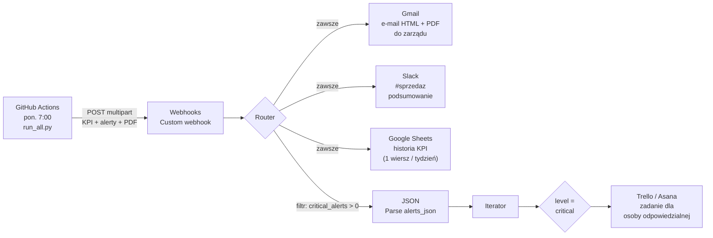

# Automatyzacja w Make – dystrybucja raportu tygodniowego

Python liczy KPI i generuje raport. **Make odpowiada za całą komunikację**: kto dostaje raport, w jakiej formie
i co się dzieje, gdy pojawi się alert krytyczny. Dzięki temu zmiana odbiorców, kanału czy treści wiadomości
nie wymaga programisty.

## Scenariusz 1: „Raport tygodniowy – dystrybucja”

| # | Moduł | Konfiguracja |
|---|---|---|
| 1 | **Webhooks › Custom webhook** | Nowy webhook `vitaforge-weekly-report`. Adres wklej jako sekret `MAKE_WEBHOOK_URL` w repozytorium GitHub. Struktura danych ustali się automatycznie po pierwszym wywołaniu (`python src/notify.py` z ustawionym adresem). Pola: `week`, `date_from`, `date_to`, `revenue`, `revenue_change_pct`, `orders`, `roas`, `gross_margin_pct`, `critical_alerts`, `alerts_json`, `slack_text`, `email_html`, plik `report_pdf`. |
| 2 | **Flow Control › Router** | 4 trasy opisane niżej. |
| 3a | **Gmail › Send an email** | **To:** lista zarządu (lub zmienna z Data Store). **Subject:** `Raport sprzedaży {{1.week}}: {{formatNumber(1.revenue; 0; ","; " ")}} zł ({{1.revenue_change_pct}}% t/t)`. **Content type:** HTML, **Content:** `{{1.email_html}}`. **Attachments:** File name `{{1.report_pdf.name}}`, Data `{{1.report_pdf.data}}`. |
| 3b | **Slack › Create a message** | Kanał `#sprzedaz`, tekst `{{1.slack_text}}` (gotowy markdown Slacka z emoji statusu alertów). |
| 3c | **Google Sheets › Add a row** | Arkusz `KPI tygodniowe`: kolumny Tydzień, Od, Do, Przychód, Zmiana %, Zamówienia, ROAS, Marża %, Alerty krytyczne. Z tego arkusza zarząd może budować własne zestawienia (np. Looker Studio). |
| 3d | **Filtr** `critical_alerts > 0` → **JSON › Parse JSON** (`{{1.alerts_json}}`, struktura: tablica obiektów `level`, `title`, `detail`) → **Flow Control › Iterator** → **Filtr** `level = critical` → **Trello › Create a card** (lub Asana › Create a task) | Tytuł karty `{{title}}`, opis `{{detail}}`, termin = dziś + 1 dzień, lista „Do wyjaśnienia”. Każdy alert krytyczny staje się zadaniem z właścicielem, a nie tylko linijką w mailu. |

### Obsługa błędów
- Moduły Gmail i Slack: **Error handler › Break** z 3 próbami co 5 minut (chwilowe błędy API).
- Cały scenariusz: powiadomienie e-mail do właściciela automatyzacji przy nieudanym wykonaniu (ustawienia scenariusza › *Notify on error*).
- Po stronie Pythona `notify.py` zwraca błąd (`raise_for_status`), więc nieudane wysłanie jest widoczne w logu GitHub Actions.

### Zużycie operacji
Jedno wykonanie tygodniowo ≈ 6–10 operacji (webhook, router, 3 akcje + iteracja alertów) → ok. 40 operacji miesięcznie. Mieści się w darmowym planie Make.

## Scenariusz 2 (wdrożenie produkcyjne): zbieranie prawdziwych danych

W wersji demo dane generuje `generate_data.py`. U klienta zastępuje go scenariusz Make uruchamiany codziennie o 2:00:

| # | Moduł | Rola |
|---|---|---|
| 1 | **Shopify › Search orders** (lub WooCommerce › Watch orders) | zamówienia ze sklepu WWW z ostatniej doby |
| 2 | **HTTP › Make a request** do REST API Allegro (`GET /order/checkout-forms`) z połączeniem OAuth 2.0 | zamówienia Allegro |
| 3 | **Amazon Seller Central** (SP-API, raport `GET_FLAT_FILE_ALL_ORDERS_DATA_BY_ORDER_DATE_GENERAL`) | zamówienia Amazon.pl |
| 4 | **Facebook Ads / Google Ads › Get insights** + raporty Allegro Ads | dzienne wydatki reklamowe |
| 5 | **Tools › Set variable / Array aggregator** → **CSV › Create CSV** | ujednolicenie do formatu `orders_raw.csv` i `marketing_spend.csv` |
| 6 | **GitHub › Create or update a file** (lub Google Drive › Upload) | zapis plików do `data/raw/` |
| 7 | (w poniedziałki) **HTTP › Make a request** `POST /repos/{owner}/{repo}/actions/workflows/weekly-report.yml/dispatches` | uruchomienie pipeline'u z flagą `--skip-generate` |

Pipeline czyszczący (`clean_data.py`) jest celowo napisany pod „brudne” dane z kilku kanałów – mieszane formaty dat,
przecinki dziesiętne z Allegro, duplikaty z podwójnego eksportu – dlatego podmiana źródła nie wymaga zmian w raportowaniu.
