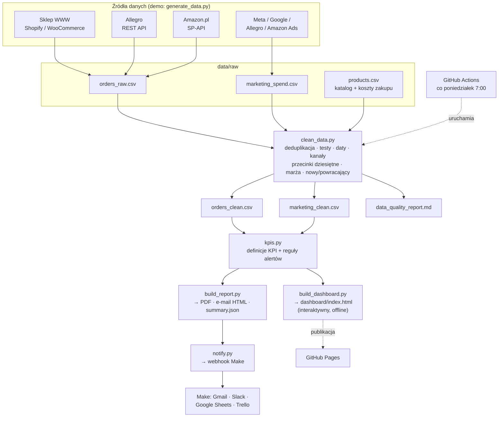

# Architektura rozwiązania

## Decyzje projektowe

| Decyzja | Uzasadnienie |
|---|---|
| **Python do obliczeń, Make do komunikacji** | Logika KPI jest wersjonowana i testowalna w kodzie. Odbiorcy, kanały i treści wiadomości zmienia się w Make bez programisty. |
| **Jeden moduł KPI** (`kpis.py`) | Jedna definicja „przychodu” czy „marży” w całej firmie – koniec dyskusji, czyja tabelka ma rację. |
| **Dashboard jako jeden plik HTML bez bibliotek** | Działa offline, otwiera się w każdej przeglądarce, hosting za 0 zł (GitHub Pages), brak licencji BI. Przy większej skali ten sam `orders_clean.csv` można podpiąć do Looker Studio lub Power BI. |
| **Wykresy w SVG pisane od zera** | Pełna kontrola nad czytelnością: jedna oś Y, etykiety bezpośrednie przy liniach, paleta sprawdzona pod kątem daltonizmu, tryb ciemny, tooltipy. |
| **Raport PDF z HTML przez Chrome headless** | Ten sam szablon do podglądu w przeglądarce i do druku; polskie znaki i fonty bez problemów. |
| **Raport jakości danych przy każdym uruchomieniu** | Widać, ile wierszy poprawiono i dlaczego – zaufanie do liczb. |
| **Progi alertów w konfiguracji** | Biznes ustala, co jest „problemem”, bez zmian w kodzie. |
