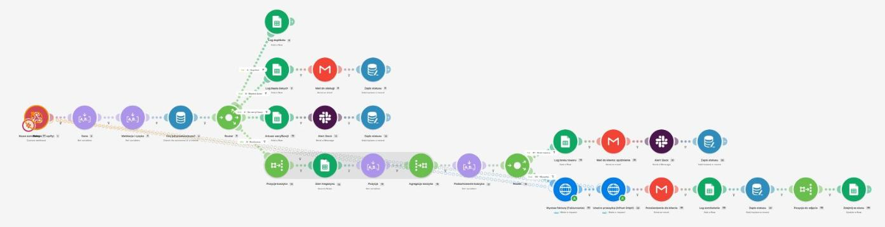
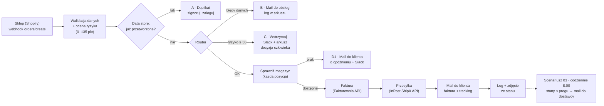
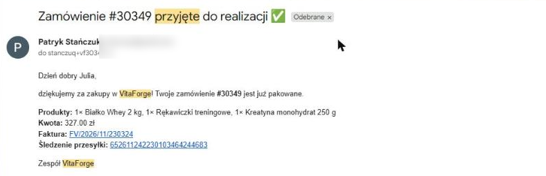
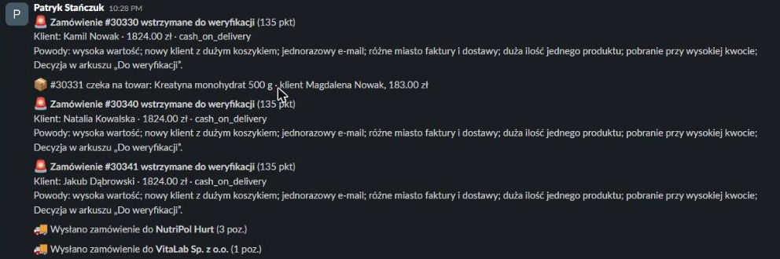

# Automatyzacja obsługi zamówień e-commerce w Make

**Od nowego zamówienia do faktury, etykiety InPost i maila do klienta, bez ręcznej pracy. Z walidacją danych, oceną ryzyka, kontrolą magazynu i automatycznym zamawianiem u dostawców.**

Make · Google Sheets · Gmail · Slack · REST API (Fakturownia, InPost ShipX) · Python (symulator i testy)



> Projekt dla fikcyjnego sklepu z suplementami **VitaForge**, tego samego co w projekcie
> [Dashboard sprzedażowy z raportem](../01-dashboard-sprzedazowy). Dashboard pokazuje, *co się dzieje*
> w sprzedaży. Ta automatyzacja *obsługuje* każde zamówienie, zanim ktokolwiek musi na nie spojrzeć.

---

## Problem biznesowy

W małym sklepie internetowym każde zamówienie to kilka ręcznych kroków w różnych systemach:

1. sprawdzić, czy dane klienta są kompletne (kod pocztowy, telefon, paczkomat),
2. sprawdzić stan magazynu,
3. wystawić fakturę w programie do faktur,
4. utworzyć przesyłkę u kuriera i skopiować numer śledzenia,
5. wysłać klientowi maila z fakturą i numerem przesyłki,
6. pilnować, czego zaczyna brakować, i pamiętać o zamówieniu u dostawcy.

Przy 40 zamówieniach dziennie i ok. 5 minutach na zamówienie to **ponad 3 godziny dziennie** przepisywania danych (szacunek).
Do tego dochodzą błędy: paczka z literówką w kodzie pocztowym wraca, wyprzedany produkt zostaje sprzedany,
a nieodebrane pobranie za 1800 zł to koszt wysyłki w dwie strony i towar zablokowany na dwa tygodnie.

## Rozwiązanie

Trzy scenariusze Make, które przejmują cały proces i angażują człowieka tylko tam, gdzie decyzja wymaga oceny.



| Scenariusz | Wyzwalacz | Co robi |
|---|---|---|
| **01 · Przyjęcie i realizacja zamówienia** | webhook z Shopify | 29 modułów, 5 tras: walidacja, ryzyko, idempotencja, magazyn, faktura, przesyłka, komunikacja |
| **02 · Mock API** | webhook | udaje Fakturownię i InPost w ich formacie odpowiedzi; produkcja = podmiana 2 adresów |
| **03 · Stany → zamówienia do dostawców** | codziennie 8:00 | produkty poniżej progu grupuje per dostawca i wysyła **jeden** mail z tabelą do każdego |

Szczegóły, moduł po module, są w [`docs/instrukcja-budowy.md`](docs/instrukcja-budowy.md), a reguły w [`docs/reguly-biznesowe.md`](docs/reguly-biznesowe.md).

### Decyzje projektowe, które robią różnicę

- **Idempotencja.** Shopify ponawia webhooki, gdy nie dostanie odpowiedzi. Data store pamięta przetworzone ID, więc żadne zamówienie nie zostanie zafakturowane dwa razy.
- **Sequential processing.** Zamówienia są przetwarzane po kolei, więc dwóch klientów nie kupi tej samej ostatniej sztuki.
- **Stan zdejmowany na końcu.** Jeśli API faktur padnie w połowie, magazyn się nie rozjedzie, a wykonanie czeka w *incomplete executions* na ponowienie (3 próby co 5 min).
- **Ryzyko punktowe zamiast pojedynczych reguł.** Jeden sygnał (duże zamówienie, prezent do innego miasta) nie blokuje klienta. Wstrzymuje dopiero kombinacja sygnałów.
- **Kontraktowy mock API.** Scenariusz 01 wysyła zapytania w prawdziwym formacie Fakturowni i InPost ShipX, a mock odpowiada w ich formacie. Przejście na produkcję nie zmienia logiki.
- **Symulator jako wyrocznia testów.** `simulator/rules.py` to te same reguły co w Make. Dla każdego zamówienia testowego zapisuje, co Make *powinien* zrobić, więc wynik da się porównać.

## Efekt

| Przed | Po |
|---|---|
| ~5 min ręcznej pracy na zamówienie (szacunek) | 0 min dla zamówień na trasie D2; człowiek zajmuje się tylko wyjątkami |
| błędny kod pocztowy wychodzi przy zwrocie paczki | zamówienie zatrzymane przed wysyłką, obsługa dostaje maila z listą problemów |
| sprzedaż wyprzedanego towaru | klient od razu dostaje informację o opóźnieniu, nikt nie pakuje niepełnej paczki |
| podejrzane pobrania wysyłane w ciemno | wstrzymanie i alert na Slacku z powodami (np. 135 pkt: 6 sygnałów) |
| „zamówiłem już u dostawcy?” | jeden mail dziennie do każdego dostawcy, status w arkuszu, zero podwójnych zamówień |

### Wyniki testów

<!-- Uzupełnij po teście T6 (docs/testy.md) prawdziwymi liczbami z historii wykonań Make -->
| Metryka | Wynik |
|---|---|
| Zamówień testowych (mix) | _20_ |
| Zgodność trasy z oczekiwaną (`runs/run_*.csv`) | _…/20_ |
| Średni czas obsługi zamówienia D2 | _… s_ |
| Operacje Make na zamówienie D2 | _~24_ |

<table><tr>
<td width="50%"></td>
<td width="50%"></td>
</tr><tr><td align="center">Potwierdzenie dla klienta</td><td align="center">Alerty na Slacku</td></tr></table>

---

## Uruchomienie

```bash
pip install -r requirements.txt
python sheets/build_sheet.py          # (opcjonalnie) świeży szablon arkusza = reset magazynu
python simulator/send_orders.py       # dry run: 12 zamówień testowych do samples/, bez wysyłki
```

Wysyłka do Make (po zbudowaniu scenariuszy według [instrukcji](docs/instrukcja-budowy.md)):

```bash
python simulator/send_orders.py --scenario mix --count 20 --url https://hook.eu1.make.com/XXXX --inbox twoj.mail@gmail.com
python simulator/send_orders.py --scenario risk        # pojedyncze przypadki: ok | invalid | risk | stockout | duplicate
```

`--inbox` zamienia e-maile klientów na aliasy Twojej skrzynki (`twoj.mail+vf12345@gmail.com`), więc wszystkie maile do „klientów” trafią do Ciebie.
Adres i skrzynkę możesz też wpisać do pliku `.env` (wzór: `.env.example`).

Przykładowy wynik:

```
nr         wartość  ryzyko  oczekiwana trasa     opis
#53326      223.00       0  D2: realizacja       poprawne zamówienie
#53327      183.00       0  D1: brak towaru      zawiera wyprzedany produkt KRE-500
#53332      150.99       0  A: duplikat          duplikat: ponowna dostawa webhooka
#53333     1824.00     135  C: do weryfikacji    podejrzane: nowy klient, jednorazowy e-mail, 12 szt., inne miasto, pobranie
#53335      124.99       0  B: błędne dane       błędne dane (zip)
```

## Struktura projektu

```
├── simulator/
│   ├── send_orders.py        # symulator webhooków Shopify: 5 scenariuszy, dry run, manifest z oczekiwaną trasą
│   ├── rules.py              # reguły walidacji i ryzyka (lustro modułu 3 w Make)
│   ├── catalog.py            # katalog, stany startowe, dostawcy
│   └── products.csv          # ten sam katalog co w dashboardzie
├── sheets/
│   ├── VitaForge_Operacje.xlsx   # szablon do importu w Google Sheets (5 zakładek)
│   └── build_sheet.py
├── make/
│   ├── blueprints/           # 02-mock-api (gotowy do importu) + eksporty 01 i 03 po zbudowaniu
│   └── build_mock_blueprint.py
├── samples/                  # przykładowe payloady zamówień + manifest.csv
└── docs/
    ├── instrukcja-budowy.md  # wszystkie 3 scenariusze moduł po module, z formułami
    ├── reguly-biznesowe.md   # walidacja, punktacja ryzyka, magazyn
    ├── testy.md              # 8 przypadków testowych + lista zrzutów ekranu
    └── opis-do-cv.md
```

## Kompetencje

- **Automatyzacja procesów w Make**: router z wykluczającymi się trasami, filtry, iteratory i agregatory (w tym grupowanie), data store, error handlery, incomplete executions, sequential processing
- **Integracje API**: REST/JSON, webhooki, mapowanie danych między formatami Shopify → Fakturownia → InPost ShipX, mock kontraktowy
- **Analiza procesu biznesowego**: mapowanie procesu AS-IS → TO-BE, reguły ryzyka oparte na realnych kosztach e-commerce (pobrania, odsprzedawcy)
- **Niezawodność**: idempotencja, kolejność operacji odporna na awarie, ponowienia
- **Testowanie**: symulator danych, przypadki brzegowe, oczekiwane wyniki zapisane przed testem

## Możliwe rozszerzenia

- Decyzja „Zatwierdź” w arkuszu `Do weryfikacji` uruchamia realizację (Google Sheets › Watch rows → ten sam ciąg co trasa D2)
- Śledzenie statusu przesyłki (InPost tworzy etykietę asynchronicznie) i mail „paczka w drodze”
- Prośba o opinię 7 dni po doręczeniu
- Klasyfikacja maili od klientów przez LLM i podpięcie [Asystenta AI obsługi klienta](../03-asystent-ai-obslugi-klienta) (projekt 3)
- Zamówienia z Allegro (REST API) obsługiwane tym samym scenariuszem po normalizacji do formatu Shopify

---

<details>
<summary><b>English summary</b></summary>

**End-to-end e-commerce order automation in Make** for a fictional supplements store. A Shopify `orders/create` webhook
triggers a 29-module scenario that validates customer data (email, postcode, phone, parcel locker), scores fraud/non-delivery
risk (6 weighted signals, hold at ≥50 pts), prevents double processing with a data store (Shopify retries webhooks),
checks stock per line item, issues an invoice (Fakturownia API format), creates an InPost ShipX shipment, emails the customer,
logs everything to Google Sheets and decrements stock last so a mid-run API failure cannot corrupt inventory (Break handler,
3 retries, incomplete executions, sequential processing). A daily scenario groups low-stock items per supplier and sends one
purchase-order email each. A Python simulator generates realistic Shopify payloads including invalid, risky, out-of-stock and
duplicate orders, and records the expected route for every order so results can be verified against Make's execution history.
</details>

**Autor:** Patryk Stańczuk · projekt portfolio
