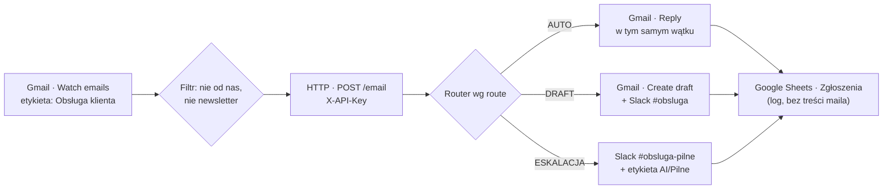

# Scenariusz Make: maile od klientów → Asystent AI → odpowiedź, szkic albo eskalacja

Scenariusz łączy asystenta ze skrzynką sklepu. Make robi to, w czym jest najlepszy (Gmail, Slack, Sheets, harmonogram),
a „mózg” (klasyfikacja, baza wiedzy, zabezpieczenia, polityka) jest w API asystenta i da się go testować w Pythonie.



## 0. Przygotowanie

1. Uruchom API: `uvicorn api.server:app --port 8000`. Make działa w chmurze, więc potrzebuje publicznego adresu:
   - na czas testów: `cloudflared tunnel --url http://localhost:8000` (albo `ngrok http 8000`),
   - docelowo: darmowy plan Render / Railway (start: `uvicorn api.server:app --host 0.0.0.0 --port $PORT`).
2. W `.env` ustaw `ASSISTANT_API_KEY` na długi losowy ciąg. Ten sam klucz wpiszesz w module HTTP.
3. W Gmailu utwórz etykiety: `Obsługa klienta`, `AI/Wysłane`, `AI/Do akceptacji`, `AI/Pilne`
   i filtr, który maile na adres sklepu oznacza etykietą `Obsługa klienta`.
4. W Google Sheets dodaj arkusz `Zgłoszenia` z kolumnami:
   `czas | od (zamaskowany) | temat | intencja | nastrój | trasa | powód | źródła | czas_ms`.

## 1. Gmail › Watch emails
- Folder/etykieta: `Obsługa klienta`, kryterium: *Unread only*, limit: 10 na uruchomienie.
- Harmonogram scenariusza: co 15 minut (pn–pt 7–20), poza tym co godzinę.

**Filtr** za modułem (nie odpowiadamy sami sobie ani systemom):
- `From address` *Does not contain* `vitaforge.pl`
- `From address` *Does not match pattern* `(?i)no-?reply|mailer-daemon|newsletter`

## 2. HTTP › Make a request
| Pole | Wartość |
|---|---|
| URL | `https://TWOJ-ADRES/email` |
| Method | POST |
| Headers | `X-API-Key: {{klucz}}` · `Content-Type: application/json` |
| Body type | Raw · JSON |
| Parse response | Yes |
| Timeout | 60 s |

Request content:
```json
{
  "from": "{{1.from.address}}",
  "subject": "{{1.subject}}",
  "body": "{{1.text}}",
  "thread_id": "{{1.threadId}}"
}
```
Error handler na module HTTP: **Break** (3 próby co 5 min). Jeśli API leży, mail czeka w *incomplete executions*
i nie ginie. Klient nie dostanie automatycznej odpowiedzi, ale też nie dostanie błędnej.

## 3. Router (trasy wykluczające się, filtr na `{{2.data.route}}`)

**AUTO** (`route` = `AUTO`)
1. Gmail › Reply to an email: wątek `{{1.threadId}}`, treść `{{2.data.reply}}`.
2. Gmail › Modify labels: dodaj `AI/Wysłane`, oznacz jako przeczytane.

**DRAFT** (`route` = `DRAFT`)
1. Gmail › Create a draft: do `{{1.from.address}}`, temat `{{2.data.reply_subject}}`, treść `{{2.data.reply}}`, w wątku `{{1.threadId}}`.
2. Gmail › Modify labels: `AI/Do akceptacji` (mail zostaje nieprzeczytany).
3. Slack › Create a message, kanał `#obsluga`: `{{2.data.slack_text}}` + link do wątku Gmaila.

**ESKALACJA** (`route` = `ESKALACJA`)
1. Slack › Create a message, kanał `#obsluga-pilne`: `:rotating_light: {{2.data.slack_text}}`.
2. Gmail › Modify labels: `AI/Pilne`, gwiazdka.
3. (opcjonalnie) Gmail › Create a draft z `{{2.data.reply}}` jako krótkie potwierdzenie przyjęcia zgłoszenia.

## 4. Google Sheets › Add a row (po każdej trasie)
`{{now}}` · `{{replace(1.from.address; "/^(.).*@/"; "$1***@")}}` · `{{1.subject}}` · `{{2.data.intent}}` · `{{2.data.sentiment}}` ·
`{{2.data.route}}` · `{{join(2.data.reasons; "; ")}}` · `{{join(2.data.sources; ", ")}}` · `{{2.data.latency_ms}}`

Treści maila nie zapisujemy w arkuszu (RODO: minimalizacja danych). Pełna treść jest w Gmailu, a API trzyma zamaskowany log w `logs/zgloszenia.jsonl`.

## Testy scenariusza

| # | Wyślij na skrzynkę sklepu | Oczekiwany efekt |
|---|---|---|
| M1 | „Ile kosztuje dostawa do paczkomatu?” | odpowiedź w wątku w ciągu 15 min, etykieta `AI/Wysłane` |
| M2 | „Gdzie jest moje zamówienie #23950?” z obcego adresu | odpowiedź AUTO z prośbą o kontakt z adresu z zamówienia, **bez** numeru przesyłki |
| M3 | „Jestem w ciąży, czy mogę pić białko?” | szkic w Gmailu + wiadomość na `#obsluga` |
| M4 | „SKANDAL!!! zgłaszam do UOKiK” | alert na `#obsluga-pilne`, brak automatycznej odpowiedzi |
| M5 | wyłącz API i wyślij M1 | wykonanie w *Incomplete executions*; po włączeniu API i ponowieniu: jedna odpowiedź |

## Koszt operacji
Ok. 6 operacji Make na mail (Gmail, filtr, HTTP, router, 2 moduły trasy, Sheets). Przy 50 mailach dziennie to ok. 9 tys. operacji miesięcznie.
Do tego koszt tokenów Claude: liczba tokenów na wiadomość jest w wynikach ewaluacji (`eval/results/`), ceny sprawdź w aktualnym cenniku Anthropic.
